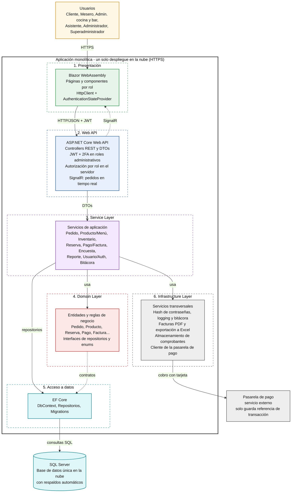

# 3. Diseño de la arquitectura del sistema

## a. Esquema visual de la arquitectura propuesta

El sistema de gestión del bar se plantea como una **aplicación monolítica modular**: un solo proyecto desplegable en la nube, organizado internamente en capas lógicas. Las capas siguen el orden discutido en clase:

**Blazor WebAssembly → Web API → Service Layer → Domain Layer → EF Core / SQL Server → Infrastructure Layer**

**Justificación del estilo monolítico.** Se eligió un monolito modular porque el alcance del bar (un solo negocio, un solo equipo de desarrollo y una única base de datos) no justifica la complejidad operativa de los microservicios. Todo se compila y se despliega como una unidad, lo que simplifica las pruebas, el mantenimiento y los respaldos. Las capas se mantienen separadas dentro del código, así que si el sistema crece, los módulos se pueden extraer a futuro sin reescribirlo todo. Solo quedan fuera del monolito la base de datos y la pasarela de pago, que son servicios externos.

---

## b. Roles de cada componente

### i. ¿Qué hace el Web API?

El Web API (ASP.NET Core) es el punto de entrada del servidor y la única puerta por la que el cliente accede a la lógica y a los datos. Sus responsabilidades son:

- Exponer los endpoints REST (controllers) para pedidos, menú, inventario, reservas, pagos, encuestas y reportes.
- Autenticar a los usuarios del personal mediante JWT y verificación en dos pasos para los roles administrativos.
- Validar en el servidor los permisos de cada rol, sin confiar en lo que muestre la interfaz.
- Validar los datos de entrada, manejar los errores y devolver respuestas HTTP con los códigos adecuados.
- Transformar los datos entre entidades y DTOs para no exponer el modelo interno.
- Mantener el hub de SignalR que notifica en tiempo real los cambios de estado de los pedidos.

Todo esto se hace sin contener reglas de negocio: el API recibe la petición y la delega a la capa de servicios.

### ii. ¿Cómo consume datos el cliente Blazor?

Blazor WebAssembly se ejecuta en el navegador del cliente (tablet de la mesa, celular o PC del personal). No tiene acceso directo a la base de datos, así que consume los datos únicamente a través del Web API:

1. El componente Blazor llama a un servicio del lado cliente que usa `HttpClient`.
2. La petición viaja al endpoint correspondiente del API, con el token JWT en la cabecera `Authorization` cuando el usuario es del personal.
3. El API responde con JSON, que se deserializa a DTOs.
4. El componente actualiza la interfaz con esos datos.

El `AuthenticationStateProvider` guarda el estado de sesión y el rol del usuario para mostrar u ocultar opciones. El cliente solo muestra lo que el rol permite, pero la validación real siempre se repite en el servidor. Para el seguimiento del pedido, además de las consultas normales, el cliente mantiene una conexión de SignalR que le empuja las actualizaciones sin tener que recargar.

### iii. ¿Cómo se comunican ambos?

| Aspecto | Descripción |
|---|---|
| Protocolo | HTTPS en todas las comunicaciones, con cifrado en tránsito |
| Estilo | API REST con peticiones HTTP (GET, POST, PUT, DELETE) |
| Formato | JSON, mediante DTOs |
| Autenticación | Token JWT en la cabecera `Authorization` para el personal; los clientes acceden con la sesión vinculada a su mesa |
| Tiempo real | SignalR (WebSockets) para notificar de forma automática el estado de los pedidos a cocina, bar y cliente |
| Despliegue | Al ser un monolito, Blazor y el Web API se publican juntos en el mismo servidor, por lo que no hay problemas de CORS entre ellos |

### iv. ¿Cuál es la funcionalidad de cada capa?

| Capa | Funcionalidad |
|---|---|
| **Blazor WebAssembly (Presentación)** | Interfaz de usuario. Muestra páginas y componentes según el rol (menú interactivo para el cliente, paneles de cocina y bar, reservas, reportes). Captura las acciones del usuario y las envía al API. No contiene lógica de negocio ni accede a datos. |
| **Web API** | Recibe las peticiones HTTP, autentica y autoriza, valida la entrada y delega el trabajo a los servicios. Devuelve las respuestas y emite las notificaciones en tiempo real. |
| **Service Layer** | Orquesta los casos de uso: registrar un pedido, descontar inventario, confirmar un pago, generar la factura, calcular reportes por jornada, etc. Coordina el dominio, los repositorios y los servicios de infraestructura. |
| **Domain Layer** | Es el núcleo del negocio. Define las entidades (Pedido, Producto, Reserva, Pago, Factura, Usuario...), las reglas (un pedido no se edita cuando ya salió de cocina o bar, un producto agotado no se puede seleccionar, una promoción vencida vuelve al precio base) y las interfaces de los repositorios. No depende de ninguna otra capa. |
| **EF Core / SQL Server (Acceso a datos)** | EF Core implementa los repositorios y traduce las entidades a tablas mediante el `DbContext` y las migraciones. SQL Server almacena la información de forma persistente, con respaldos automáticos en la nube. |
| **Infrastructure Layer** | Agrupa los servicios técnicos transversales: hash de contraseñas, logging y bitácora inmutable, generación de facturas en PDF, exportación de reportes a Excel, almacenamiento de comprobantes de transferencia y el cliente de la pasarela de pago (solo se guarda la referencia de la transacción, nunca los datos de la tarjeta). |

**Flujo resumido de una petición.** El cliente Blazor envía la petición por HTTPS al Web API, que la valida y la pasa a la capa de servicios. El servicio aplica las reglas del dominio, consulta o guarda los datos a través de EF Core en SQL Server y, si hace falta, usa la infraestructura (por ejemplo, para cobrar con tarjeta). La respuesta sigue el camino inverso hasta llegar a la pantalla del usuario.